# ESP32 based iot switch
An IOT switch designed in KiCad based on ESP32-C5 and GDEY037T03 e-paper display. All electronic components were sourced from AliExpress (wanted to try something I guess).
## ESP32-C5
32-bit single-core RISC-V MCU running at up to 240 MHz with 29 GPIOs.

- Dual-band 2.4/5 GHz connectivity
- Wi-Fi 6
- BLE 5
- Zigbee and Thread support

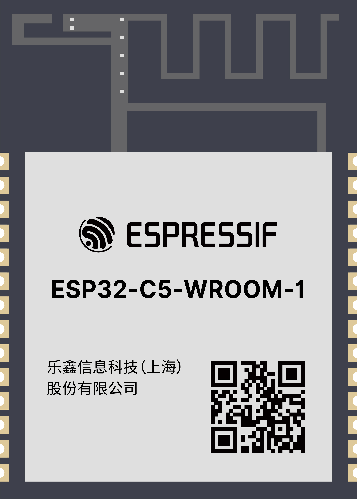

## GooDisplay GDEY037T03
3.7" black-and-white e-paper display.
- 240x416 resolution.
- 4-wire SPI interface

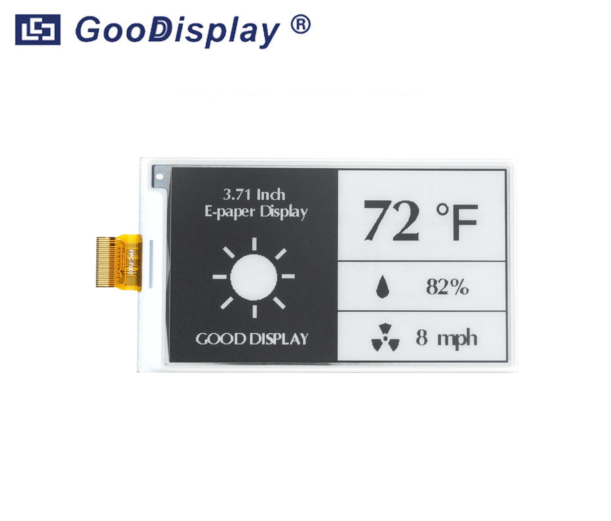

## 1. Part sourcing and Power Budget
All components used in this project were sourced from AliExpress.

A simple system block diagram was created early in the design process to estimate the power budget and guide component selection.

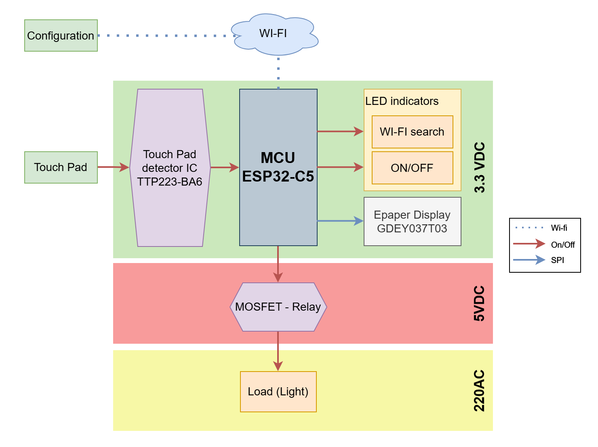

The BOM was progressively refined while developing the schematic. BOM in "spreadsheets" folder.
## 2. Schematic and PCB layout
The schematic was designed using reference circuits from datasheets, application notes, and technical articles.

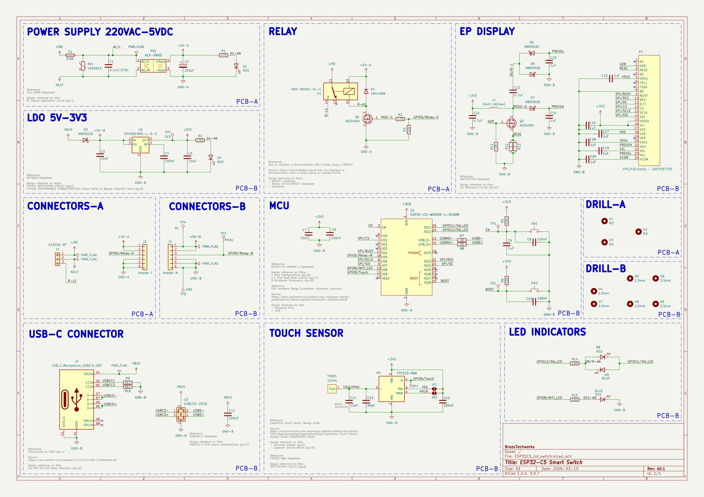

The PCB layout shows some of the mechanical constraints of the enclosure.

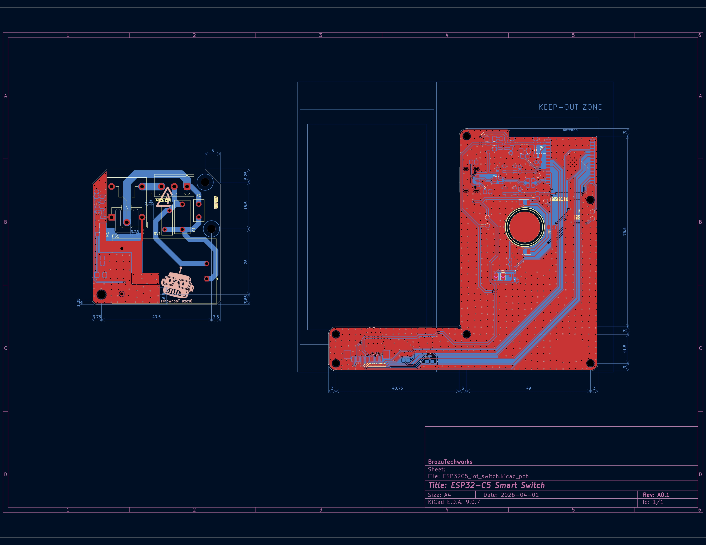

|  |  |
|-----------|-----------|
| 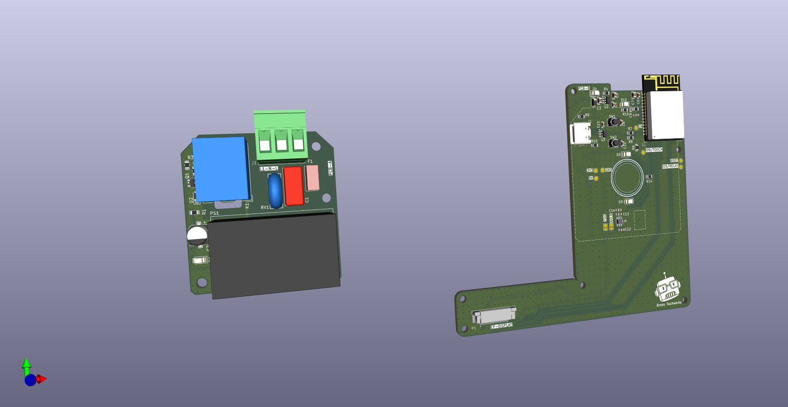 | 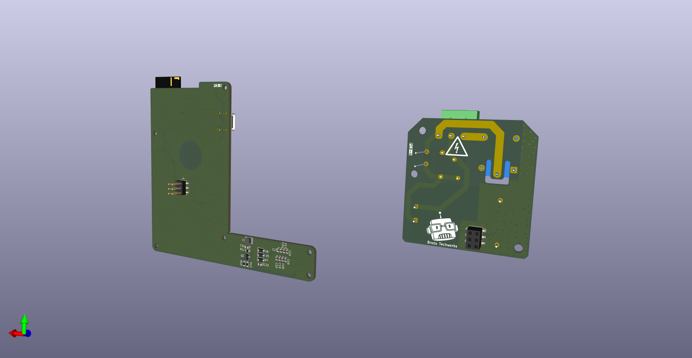 |
## 3. PCB Assembly
All components were manually assembled and soldered with a soldering iron (yeah...). 

PCB-A
|  |  |
|-----------|-----------|
| 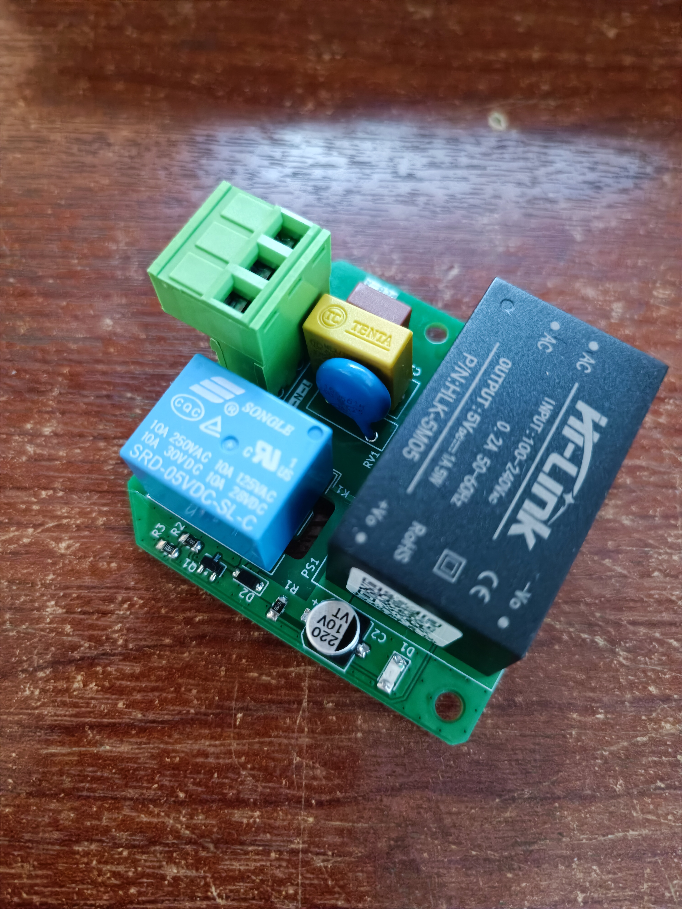 | 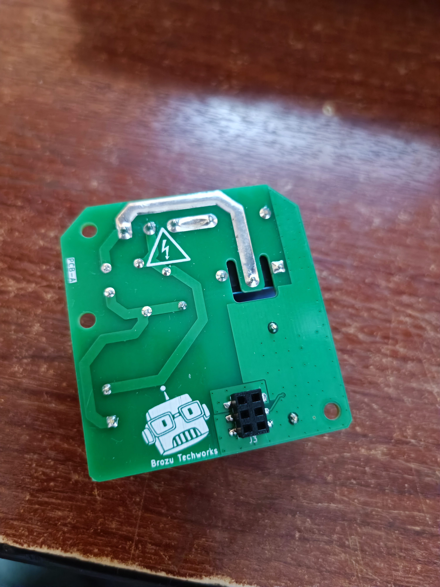 |

PCB-B
|  |  |
|-----------|-----------|
| 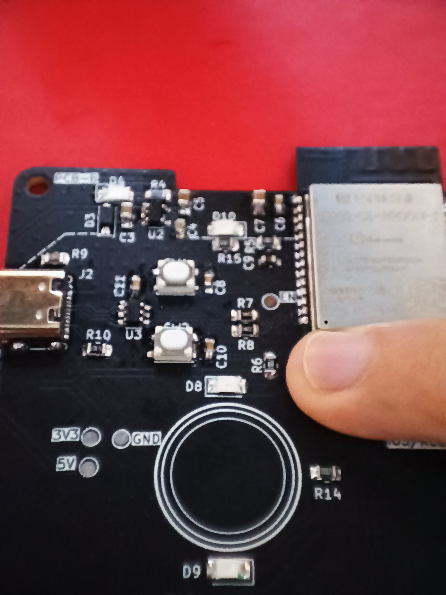 | 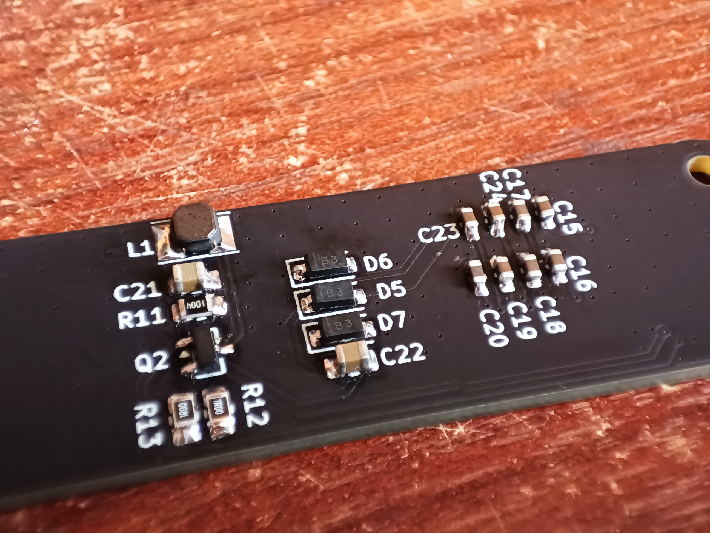 |
## 4. Firmware
Firmware development started with the development of an integration library between the GDEY037T03 e-paper display and the Adafruit GFX library

The library can currently be found on https://github.com/mynameisbrozu/GDEY037T03-AdafruitGFX.

Features:

-Relay control and sync: A tap toggles the relay and the red/blue status LEDs, and reports the new state to SinricPro. Remote commands from SinricPro update the relay and the display.
-WiFi setup: A 5-second long press opens a captive config portal (non-blocking, with a QR code on the display, a blinking LED, and a 5-minute timeout). If WiFi is already saved, a long press resets the stored settings and restarts the device.
-Local web interface: An async web server shows a config page where you can set your location (with autocomplete via the Open-Meteo Geocoding API) and your SinricPro credentials (key, secret, device ID). These are stored in NVS flash, and the device restarts when credentials change.
-Weather and date display: NTP syncs the clock, and current temperature and weather conditions are fetched from Open-Meteo every 30 minutes. The e-paper screen shows the day, date, month, temperature, city, and a weather icon. When offline it shows a light bulb and switch icon instead.
-Extra: A 10-second hardware watchdog, WiFi auto-reconnect, retry logic for HTTP and SinricPro calls, and bilingual UI text only configurable via firmware(English/Spanish).

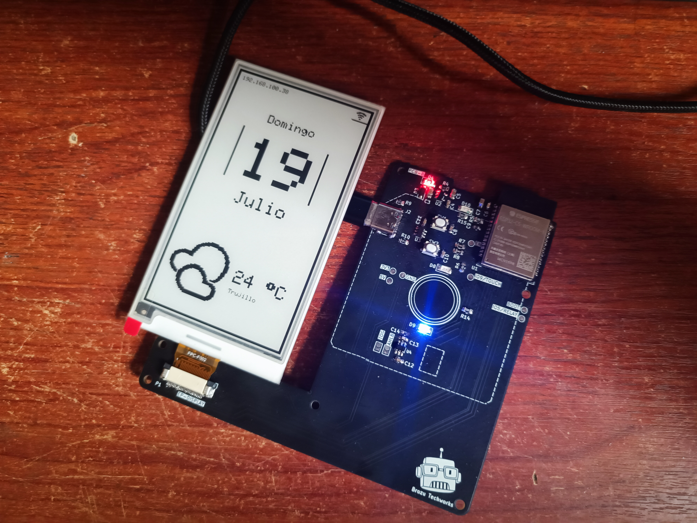

## 5. Enclosure...
The enclosure was designed in Autodesk Inventor. Documentation, assembly instructions, and design notes are still in progress and will be added soon.

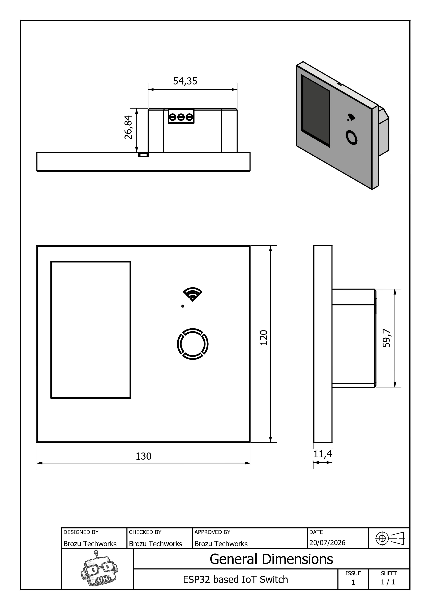

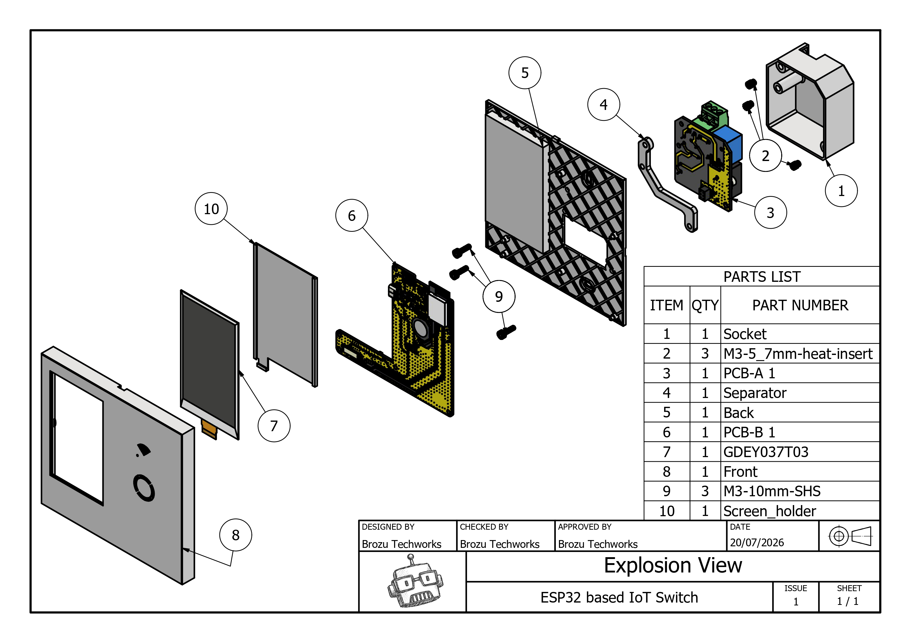
